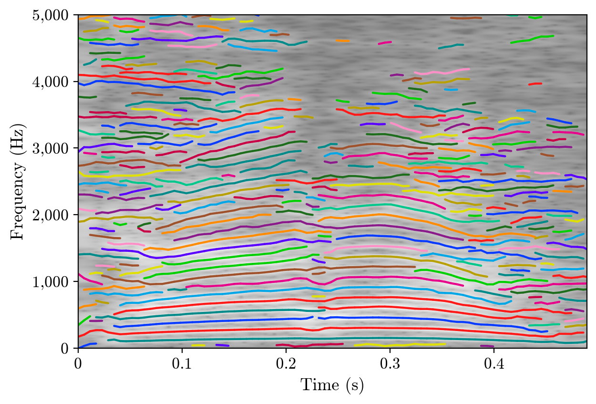

# fast-partial-tracking

Sinusoidal partial tracking for audio, in Python, implementing J. Neri and P. Depalle,
[*Fast Partial Tracking of Audio with Real-Time Capability through Linear Programming*](https://www.dafx.de/paper-archive/2018/papers/DAFx2018_paper_26.pdf)
(DAFx-18).

Each analysis frame is modelled as a sum of generalized sinusoids, estimated with the
Distribution Derivative Method. Peaks in consecutive frames are linked by solving a
linear assignment problem, which gives partials (sinusoidal trajectories) that can be
resynthesized, edited, plotted or exported. The package includes:
- a streaming tracker that runs in real time
- a toolkit for editing partials (pruning, selection, pitch shift, time stretch)
- modern file formats (Parquet, Arrow) plus SDIF
- an interactive web app

A preset reproduces the original [MATLAB code](https://github.com/jundsp/Fast-Partial-Tracking)
exactly, and tests check this against reference data exported from MATLAB.



*Partials of the bundled voice recording (/kara/), each in its own color, over the spectrogram (`fpt.plot.figure(fpt.track(x, fs, fpt.AnalysisConfig(threshold_db=-50)), x)`).*

## Install

Not on PyPI yet; install from GitHub (needs git):

```sh
pip install "fast-partial-tracking[all] @ git+https://github.com/jundsp/fast-partial-tracking-py.git@v0.2.0"
```

That installs everything. Without `[all]` you get the core: analysis, tracking, synthesis,
file formats, plotting, the `fpt` command, and the numexpr speed-up (about 1.7× faster
single-threaded). That is the right choice when another package depends on this one. For
specific extras use e.g. `[ui]`. With uv, use the same string with `uv add` (in a project)
or `uv pip install`. Replace `@v0.2.0` with `@main` for the latest unreleased code. Extras:

| extra | adds |
|---|---|
| `ui` | the web app (`fpt ui`): streamlit, plotly |
| `dataframes` | `Partials.to_polars()` / `to_pandas()` |
| `live` | sounddevice, for `examples/live_microphone.py` |
| `all` | all of the above |

### From a clone

```sh
git clone https://github.com/jundsp/fast-partial-tracking-py.git
cd fast-partial-tracking-py
uv sync --extra dev
```

`--extra dev` installs every optional feature plus the test tools; prefix commands with
`uv run` (e.g. `uv run fpt ui`). Without uv: `pip install -e ".[dev]"`.

## Quick start

```python
import fast_partial_tracking as fpt

x, fs = fpt.data.demo_sound()          # or soundfile.read("your.wav")
partials = fpt.track(x, fs)            # Partials(1131 partials, 86 frames, ...)
y = fpt.synthesize(partials)
fpt.rsnr(x, y)                         # 22.5 dB reconstruction SNR (eq. 18)

fpt.plot.figure(partials, x, out_path="voice.png")  # the figure above
partials.save("voice.parquet")         # or .arrows / .sdif / .bin
```

## Web app

```sh
fpt ui
fpt ui your.wav
```

Without a file it opens the demo voice; synthetic test signals and file upload are in the
sidebar.

- **Settings:** tune the window, hop, Q, threshold, δ, ζ_f and ζ_a in the sidebar, with a MATLAB preset available. Results are cached, so moving sliders back and forth is instant.
- **View:** zoom into the partials drawn over the spectrogram; hover a line to see its partial number, frequency and level.
- **Listen:** play the original, the resynthesis and the residual, or solo a frequency band or chosen partials.
- **Transform:** pitch shift, time stretch or change the gain and hear the result immediately.
- **Export:** download Parquet, SDIF, WAV, or the settings as JSON for use with `fpt analyze --config`.

## Working with partials

```python
p = fpt.track(x, fs)
p.prune(min_frames=3)                                   # drop short, mostly spurious partials
p.select(time_s=(0.1, 0.3), frequency_hz=(100, 4000), min_amplitude_db=-60)
p.filter_tracks(lambda t: t.mean_frequency_hz < 1000)  # keep whole partials by a rule
for t in p.tracks():                                    # Track: id, time_s, frequency_hz, amplitude, ...
    print(t)                                            # Track(id=639, 39 frames, 0.231-0.451 s, 445.5 Hz, peak -11.0 dB)
p.stats(); p.to_polars()                                # summary numbers / long table

higher = fpt.transforms.pitch_shift(p, semitones=5)
slower = fpt.transforms.time_stretch(p, 1.5)
fpt.synthesize(slower)   # transformed results automatically use phase-integrating synthesis
```

The point-by-point columns (`frequency_hz`, `amplitude`, `amplitude_db`, `phase`, `time_s`,
`track_id`) are all NumPy arrays. `alpha` holds the full short-term model of each point
(eq. 4), including frequency and amplitude slopes.

## Streaming and real time

Linking only needs the previous and current frame (Section 3.7 of the paper), so audio can
be pushed in blocks of any size. Each frame is final one frame after it was analysed, and
memory use stays constant however long the stream runs.

```python
analysis = fpt.AnalysisConfig(threshold_db=-75, threshold_reference="full_scale")  # causal threshold
tracker = fpt.PartialTracker(fs, analysis)
synth = fpt.Synthesizer(tracker.grid)
with fpt.io.open_writer("live.arrows", tracker.grid, order=2) as writer:
    for frame in tracker.process(audio_blocks):     # any iterable of numpy blocks
        writer.write_frame(frame)
        play(synth.push(frame))
    writer.set_summary(tracker.grid, tracker.num_tracks)
```

## Settings

`AnalysisConfig` (Section 3.2) validates every value and never silently changes one.

| field | default | meaning |
|---|---|---|
| `window_length` | 2047 | N in samples (`AnalysisConfig.from_duration(fs, window_ms=46)` sets it from a duration) |
| `hop_size` | N/8 (Blackman-Harris), N/4 (Hann) | H |
| `n_fft` | next power of 2 ≥ 2N | DFT size |
| `window` | `"blackman_harris"` | or `"hann"` |
| `poly_order` | 2 | Q of the short-term model (eq. 4). 1 = frequency and amplitude slope; 2 adds their curvature |
| `threshold_db` | -60 | peaks below the reference by more than this are ignored |
| `threshold_reference` | `"signal"` | the loudest frame of the input, `"full_scale"` (a sine of amplitude 1), or a dB value |
| `geometry` | `"centered"` | frame k is centred on sample k·H |

`TrackingConfig` (Sections 3.3–3.4):
- **`delta`** (δ, default 0.2): the preference for continuing partials over spurious links.
- **`zeta_f_hz`** (ζ_f, default 50) and **`zeta_a_db`** (ζ_a, default 15): the frequency and level differences at which a link switches from useful to spurious (eqs. 12–13).

## Command line

```sh
fpt analyze in.wav -o partials.parquet --report
fpt analyze long.wav -o partials.arrows --stream
fpt analyze in.wav -o p.parquet --preset matlab
fpt analyze in.wav -o p.parquet --config settings.json --prune 3
fpt synth partials.parquet -o resynthesis.wav
fpt convert partials.parquet -o partials.sdif
fpt plot partials.parquet -o partials.png --audio in.wav
fpt info partials.parquet
fpt ui in.wav
```

- `--report` prints the resynthesis R-SNR; `--stream` reads and writes block by block with
  constant memory; `--preset matlab` uses the exact MATLAB `jun_demo` settings.
- `fpt info` prints a summary and a partial-length histogram. `fpt <command> --help` lists
  every option.

## File formats

All formats share one table, with one row per partial per frame, and are written frame by
frame, so neither long nor live analyses need to fit in memory.

| extension | format | use |
|---|---|---|
| `.parquet` | Apache Parquet | Recommended. Columnar and zstd-compressed. Opens directly in pandas, polars, DuckDB and MATLAB (`parquetread`). |
| `.arrows` | Arrow IPC stream | Live pipelines: can be read while it's still being written (`fpt.io.iter_arrow_stream`). |
| `.sdif` | SDIF `1TRC`, binary | SDIF tools such as AudioSculpt and OpenMusic. Written directly; checked with IRCAM's SDIF library. |
| `.bin` | MATLAB demo format | Byte-compatible with `jun_write_partials.m` / `jun_read_partials.m`. |

Columns: `frame`, `time_s`, `track_id`, `frequency_hz`, `amplitude` (the real sinusoid's
amplitude), `phase`, and optionally `alpha_re`/`alpha_im`. The settings and frame grid
are stored as JSON metadata (format version 2; version 1 files from 0.1 still read).

## Performance

Tracking 10 s of 44.1 kHz audio (window N = 2047) on a 10-core laptop:
- **`fpt.track` (all cores):** about 0.9 s, roughly 10× faster than real time.
- **Single thread with numexpr:** 1.2 s.

`examples/benchmark.py` measures this on your machine.

## Relation to the MATLAB code

`AnalysisConfig.matlab(...)` and `TrackingConfig.matlab(...)` reproduce
`jun_track_partials.m`. On eight reference signals (Hann and Blackman-Harris windows,
Q = 1–3, odd and even N), the tests check every stage against data exported from MATLAB
(`matlab/export_reference.m`): spectra, peaks, DDM coefficients, costs, assignments,
partial labels, and resynthesis to about 1e-14.

The default frame placement deliberately differs: the model origin is the window centre,
where MATLAB's is one sample off. Quality is unchanged (+0.02 dB mean R-SNR).

Both repositories carry the same fixes:
- **Paper equations:** the cost variances and frame midpoint now follow eqs. 10–13.
- **Amplitude check:** estimates whose amplitude at the frame centre is impossibly large are rejected. The original check compared a log value with a linear bound and almost never triggered. Q = 3 models gain up to +10 dB; Q = 2 is unchanged or better. `amplitude_guard="legacy"` reproduces the old check.

## Where the paper lives in the code

| paper | code |
|---|---|
| eqs. 1–2, sinusoidal model | `partials.py` (`amplitude = 2·exp(a)`), `synthesis/` |
| eq. 3 and §2.2, assignment problem and Hungarian algorithm | `tracking/assignment.py` |
| eqs. 4–7, short-term model and its DDM estimation (Betser 2009) | `analysis/model.py`, `analysis/ddm.py` |
| eqs. 8–11, useful and spurious costs at the frame midpoint | `tracking/cost.py` |
| eqs. 12–13, σ from ζ and δ | `tracking/cost.py::cost_variances` |
| eq. 14 and §3.5, cost matrix and useful assignments | `tracking/cost.py`, `tracking/assignment.py` |
| §3.6, partial labeling | `tracking/labeling.py` |
| §3.7, frame-by-frame (real-time) operation | `tracking/tracker.py::PartialTracker` |
| eq. 18, R-SNR | `metrics.py` |
| McAulay–Quatieri synthesis [12] | `synthesis/mcaulay_quatieri.py` |

## Examples

| script | shows |
|---|---|
| `quickstart.py` | track, resynthesize, R-SNR and plot |
| `track_demo.py` | port of MATLAB `jun_demo.m` (MATLAB preset) |
| `harmonic_residual.py` | split a sound into its sinusoidal part and noise residual |
| `pitch_shift_time_stretch.py` | transforms with phase-integrating synthesis |
| `polyphonic.py` | a chord and crossing chirps, each partial in its own colour |
| `parameter_sweep.py` | R-SNR vs δ, ζ_f and Q; default vs MATLAB frame placement |
| `streaming_demo.py` | block streaming to an Arrow file with live resynthesis; memory plot |
| `live_microphone.py` | real-time microphone tracking with a live plot (`--simulate` without a mic) |
| `formats.py` | Parquet/Arrow/SDIF round trips; querying with polars |
| `benchmark.py` | speed per stage and thread count |
| `matlab_comparison_report.py` | Python vs MATLAB, per test case |

Outputs go to `~/Documents/output/fast-partial-tracking/examples/<name>/` (override with `--out`).

## Live microphone

```sh
uv run python examples/live_microphone.py --seconds 20
```

Tracks your default input device in real time and draws the partials as a scrolling
image. The title shows the lag (audio waiting to be processed); it stays around one block
(~25 ms) when the machine keeps up, and a warning is logged if it passes 0.5 s. Lower
`--fps` if the display is slow on your machine. macOS asks for microphone permission for
your terminal on first use (System Settings → Privacy & Security → Microphone). Add
`--simulate` to replay the demo voice at real-time pace instead.

## Development

```sh
uv sync --extra dev
uv run pytest
uv run pytest -m "not examples"
uv run pytest --matlab
```

The first runs everything (unit, MATLAB equivalence, UI and example tests); the second
skips running the example scripts; the third re-exports the MATLAB references first
(needs MATLAB, see `matlab/export_reference.m`).

## Citation

```bibtex
@inproceedings{neri2018fast,
  author    = {Neri, Julian and Depalle, Philippe},
  title     = {Fast Partial Tracking of Audio with Real-Time Capability through Linear Programming},
  booktitle = {Proceedings of the 21st International Conference on Digital Audio Effects (DAFx-18)},
  address   = {Aveiro, Portugal},
  pages     = {326--333},
  year      = {2018}
}
```

## License

MIT. See [LICENSE](LICENSE).
